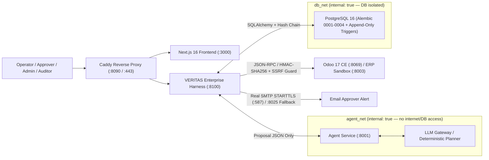

<div align="center">

# VERITAS AI

### **Control Before Action** — Deterministic Runtime Governance Harness for Enterprise AI Agents

[](https://github.com/ArrafiNurHafiz/Veritas-Ai/actions)
[](https://www.python.org/)
[](https://fastapi.tiangolo.com/)
[](https://nextjs.org/)
[](https://www.postgresql.org/)
[](#cryptographic-proof--audit-chain)

*Autonomous AI agents propose structured actions inside an isolated network—holding zero database credentials, signing keys, or direct write access. VERITAS enforces deterministic policy, human Separation of Duties, and tamper-evident Ed25519 receipts before any tool executes.*

[Quick Start (Docker)](#-quick-start-enterprise-stack) · [3-Minute Verification](#-3-minute-judge-verification-flow) · [Architecture](#-system-architecture) · [Agents & Tools](#-multi-agent-bounded-catalog) · [Test Suites](#-verification--testing) · [Pitch Deck](docs/VERITAS_AI_Build2036_Deck.pptx)

</div>

---

## Why VERITAS AI?

Enterprise AI agents are rapidly moving from read-only copilots into **ERP, Finance, HR Operations, and Cloud IAM**. Giving an LLM direct function-calling authority and live credentials creates unacceptable risk: one prompt injection or hallucinated parameter can trigger irreversible financial or security mutations.

**VERITAS AI** solves this by placing a deterministic **Runtime Governance Harness** between LLM reasoning and real enterprise systems:

| Threat / Gap | Traditional LLM SDKs | VERITAS AI (`Control Before Action`) |
| --- | --- | --- |
| **Credential Exposure** | Agent runtime holds DB/ERP API keys | **Proposal-Only Isolation** (`agent_net` internal): zero DB credentials, zero signing keys, zero outbound egress |
| **Probabilistic Guardrails** | LLM-on-LLM checks add latency & can be jailbroken | **Deterministic Python Policy Engine**: schema validation, FX normalization, allowlists, and hard caps |
| **Self-Approval / Race Conditions** | Weak or stateless checks | **Strict Separation of Duties** (`403 SEPARATION_OF_DUTIES`), optimistic locking (`expected_version`), & **Anti-TOCTOU Resume Gate** |
| **Mutable Logs** | Standard application logs can be altered | **Ed25519 Signed Receipts** (RFC 8785 canonical JSON) + **SHA-256 hash chain** enforced by PostgreSQL 16 `UPDATE`/`DELETE` triggers |

---

## System Architecture

The enterprise deployment runs as a **7-container Docker Compose stack** partitioned across **3 isolated networks** (`edge_net`, internal `agent_net`, and internal `db_net`) to prevent lateral bypass:



### Validated Execution State Machine

Every agent proposal is tracked through an explicit, audited state machine:

```
CREATED ─▶ PLANNING ─▶ POLICY_CHECK ─┬─▶ ALLOWED ─────────▶ EXECUTING ─▶ SUCCEEDED (Ed25519 Receipt)
                                     ├─▶ WAITING_APPROVAL ─▶ (SoD + Anti-TOCTOU Resume) ─▶ EXECUTING / DENIED_ON_RESUME
                                     └─▶ DENIED (0 tool calls executed)
```

---

## Multi-Agent Bounded Catalog

VERITAS governs **4 operational agents** and **8 bounded tools** via a server-side registry (`enterprise/agents.py`, `enterprise/tools.py`). Unregistered tools or LLM self-authorization claims are deterministically rejected.

| Agent | Bounded Tools | Governance Scope |
| --- | --- | --- |
| `procurement-agent` | `approve_invoice`, `check_vendor_status` | Invoice threshold tiers (`<= Rp 5M` auto-allow for `V-ABC`/`V-XYZ`, `Rp 5M–25M` human gate, `> Rp 25M` hard-cap deny) + USD/SGD/EUR FX normalization |
| `finance-risk-agent` | `audit_reconciliation`, `flag_discrepancy` | Ledger discrepancy checks and risk escalation |
| `hr-operations-agent` | `provision_workspace`, `log_badge_request` | Workspace provisioning and physical/digital badge workflows |
| `security-audit-agent` | `scan_iam_keys`, `revoke_stale_token` | Stale IAM key scanning and gated token revocation |

---

## Quick Start (Enterprise Stack)

### 1. One-Command 7-Container Docker Compose Stack

```sh
cp .env.vps.example .env
docker compose -f docker-compose.enterprise.yml up -d --build
```

Run the end-to-end live preflight verification (tests Caddy `:8090`, PostgreSQL 16, all 4 agents, 6 ERP transactions, SMTP Mail Sandbox, and `pg_dump` -> `psql` restore):

```sh
python3 scripts/enterprise_preflight.py
```

**Service Endpoints:**
- **Web UI & API Gateway (Caddy):** `http://localhost:8090`
- **Public Trust Explorer (No Login Required):** `http://localhost:8090/dashboard/trust`
- **ERP Target:** **Real Odoo 17 CE (`http://127.0.0.1:8069`)** when `VERITAS_ERP_ADAPTER=odoo` (or **ERP Sandbox** `:8003` as offline HMAC fallback)
- **Approval Email Alerts:** Real **SMTP (`STARTTLS` port `587`)** when configured in `.env`, with **Mail Sandbox** (`http://localhost:8025`) as zero-config offline fallback

### 2. Add Real Odoo 17 CE ERP (Optional Live Integration)

```sh
docker compose -f docker-compose.odoo.yml up -d
.venv/bin/python scripts/setup_odoo.py
```

Set `VERITAS_ERP_ADAPTER=odoo` and `VERITAS_ERP_WEBHOOK_URL=http://127.0.0.1:8069` in `.env` so approved invoices post directly as real Vendor Bills (`account.move`) in Odoo 17.

### 3. Local Development Stack (Without Docker)

```sh
python3 -m venv .venv
.venv/bin/pip install -r requirements.txt
./start_local.sh
```

`start_local.sh` launches the Enterprise Harness (`:8002`), Agent Service (`:8001`), and Next.js frontend (`:3000`), and automatically skips `erp_sandbox` / `mail_sandbox` when real Odoo (`VERITAS_ERP_ADAPTER=odoo`) or real SMTP is configured.

### 4. Legacy Single-Service Slice (`veritas_harness.py`)

For lightweight single-process SQLite testing (`:8002`):

```sh
.venv/bin/python seed_demo.py
.venv/bin/uvicorn veritas_harness:app --port 8002
```

---

## 3-Minute Judge Verification Flow

1. **Multi-Role Login:** Open `http://localhost:8090/login` and sign in with the pre-seeded demo personas (or switch roles across **Operator**, **Approver**, and **Admin**).
2. **Auto-Allow (`<= Rp 5M`):** In **Task Center** (`/dashboard/tasks`), dispatch an invoice of `Rp 3,200,000` to allowlisted vendor `V-ABC` -> immediately transitions to `ALLOWED` / `SUCCEEDED` with an **Ed25519 receipt**.
3. **Human Gate (`Rp 5M–25M`):** Dispatch `Rp 8,500,000` -> pauses at `WAITING_APPROVAL` with **`0` downstream tool calls**, and dispatches a real **SMTP (`STARTTLS`)** approval notification email (or captures locally in `:8025` when running offline without SMTP credentials).
4. **Separation of Duties & Commit:** Attempting to approve as the same Operator returns **`403 SEPARATION_OF_DUTIES`**. Sign in as **Approver** in `/dashboard/approvals` and approve -> Anti-TOCTOU revalidation passes and commits a real Vendor Bill to **Odoo 17 CE (`:8069`)** (or **ERP Sandbox** `:8003` offline).
5. **1-Byte Tamper Test:** Open **Public Trust Explorer** (`/dashboard/trust`), inspect any signed receipt, and trigger the **1-Byte Tamper Simulation** -> Ed25519 signature verification immediately **FAILS**.

### Pre-Seeded Demo Personas

| Role | Demo Email | Demo Bearer Token | Primary Surface |
| --- | --- | --- | --- |
| **Operator** | `marcus.vance@nexora.internal` | `tok-operator` | `/dashboard/tasks` |
| **Approver** | `sarah.jenkins@nexora.internal` | `tok-approver` | `/dashboard/approvals` |
| **Admin** | `alexa.chen@nexora.internal` | `tok-admin` | `/dashboard/agents`, `/dashboard/policies` |
| **Auditor** | `dr.rachel.k@nexora.internal` | `tok-auditor` | `/dashboard/trust` |

---

## Key Security & Governance Guarantees

- **Proposal-Only Agent Boundary:** `agent_service` (`:8001`) runs in `agent_net` (`internal: true`) with zero database credentials or signing keys. Prompt injections inside untrusted payloads are treated strictly as data.
- **Anti-TOCTOU Resume Revalidation:** When an approval is resumed, `enterprise` re-checks `policy_version`, `args_hash`, live agent status (`AGENT_DISABLED`), and vendor blocklists—enforcing `DENIED_ON_RESUME` if rules changed mid-flight.
- **Cryptographic Proof & Append-Only Audit:** Every execution issues an **Ed25519** signature over **RFC 8785** canonical JSON + nonce, chained via `prev_event_hash` (SHA-256) and protected by SQLite & PostgreSQL 16 triggers that reject `UPDATE`/`DELETE`.
- **SSRF & Webhook Security:** Outbound connectors enforce IP/host allowlists (`VERITAS_WEBHOOK_ALLOW_HOSTS`) and sign payloads with **HMAC-SHA256** (`X-Veritas-Signature`).
- **Session & Edge Hardening:** PKCE OIDC support, Scrypt password hashing, Double-Submit CSRF (`vt_csrf` + `X-CSRF-Token`), correlation IDs (`X-Correlation-ID`), and Prometheus `/metrics`.

---

## Verification & Testing

Run the full test suite:

```sh
./scripts/run_all_tests.sh
```

Or run individual suites:

```sh
# Enterprise, Odoo adapter & PostgreSQL 16 integration suite
.venv/bin/pytest -q

# Legacy slice acceptance, E2E restart-durability, seed & OpenAPI contract checks
.venv/bin/python tests/test_demo.py           # 140+ acceptance checks
.venv/bin/python tests/test_e2e.py            # 36 HTTP & restart-durability checks
.venv/bin/python tests/test_seed.py           # 9 seed checks
.venv/bin/python tests/test_openapi.py        # 9 OpenAPI contract checks
.venv/bin/python tests/test_agent_service.py  # Agent isolation checks
.venv/bin/pytest tests/test_odoo_adapter.py -q # Odoo 17 JSON-RPC adapter checks

# Frontend lint & production build
cd frontend && pnpm eslint src/ && pnpm build # 13/13 static pages
```

---

## Repository Structure

```text
.
├── enterprise/                 # Enterprise FastAPI Harness (:8100), policy, KMS, LLM gateway, Alembic (0001-0004)
├── frontend/                   # Next.js 16 (App Router) + React 19 + Tailwind CSS v4 console (:3000)
├── erp_sandbox/                # Target ERP webhook sandbox with HMAC verification (:8003)
├── mail_sandbox/               # Target SMTP & web inbox sandbox (:1025 / :8025)
├── agent_service.py            # Isolated proposal-only agent microservice (:8001)
├── llm_planner.py              # Deterministic fallback & OpenAI-compatible structured planner
├── veritas_harness.py          # Standalone SQLite slice for lightweight local testing (:8002)
├── scripts/                    # enterprise_preflight.py, setup_odoo.py, run_all_tests.sh, backup/restore_postgres.sh
├── tests/                      # Pytest enterprise, Odoo adapter, PostgreSQL, sandbox, E2E, and contract suites
├── docs/                       # Architecture docs, PRD, Runbook, Pitch Deck (.pptx), OpenAPI spec
├── Caddyfile                   # Reverse proxy config (:8090 / TLS-ready :443)
├── docker-compose.odoo.yml     # Optional live Odoo 17 CE + PostgreSQL stack (:8069)
└── docker-compose.enterprise.yml
```

---

## Documentation

- **Enterprise Runbook:** [docs/ENTERPRISE_RUNBOOK.md](docs/ENTERPRISE_RUNBOOK.md)
- **Project Status & Verification:** [docs/STATUS.md](docs/STATUS.md)
- **Build 2036 Pitch Deck:** [docs/VERITAS_AI_Build2036_Deck.pptx](docs/VERITAS_AI_Build2036_Deck.pptx)
- **Pitch Deck Reference & Guardrails:** [docs/PITCH_DECK_REFERENCE.md](docs/PITCH_DECK_REFERENCE.md)
- **Submission & Judge Guide:** [docs/submission.md](docs/submission.md)
- **API Contract Snapshot:** [docs/openapi.json](docs/openapi.json)

---

## Scope Transparency & Claim Guardrails

- **Blockchain Anchoring:** Defaults to a local mock anchor unless `VERITAS_ANCHOR_RPC_URL` is configured to point at an EVM / Hyperledger Besu node.
- **Target Connectors:** Supports **real Odoo 17 CE (`:8069`, JSON-RPC `account.move`)** and **real SMTP (`STARTTLS` port `587`)** when configured in `.env`, with `erp_sandbox` (`:8003`) and `mail_sandbox` (`:8025`) available as zero-config offline fallbacks.
- **Demo Authentication Bypass:** Pre-seeded demo credentials and role-switch helpers are enabled by default for frictionless judge testing and should be disabled behind PKCE OIDC in production cutover.
- **Mediated Governance Scope:** Outbound inspection covers traffic mediated through the VERITAS Harness; direct external calls made outside the Harness boundary are out of scope.
- **Benchmarking Note:** Reported test counts reflect actual local/Compose suite runs; large-scale concurrent production load benchmarking has not yet been executed.
